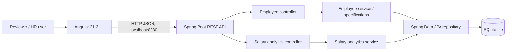
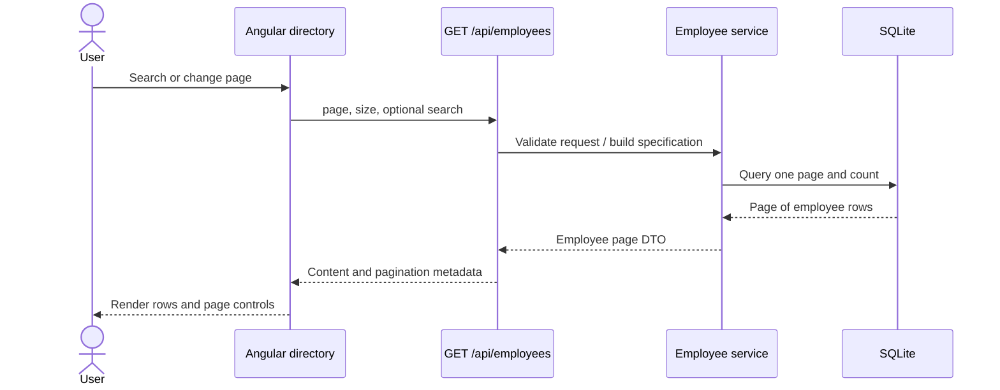
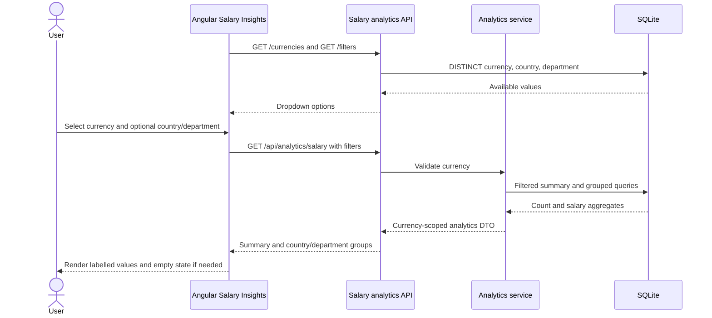
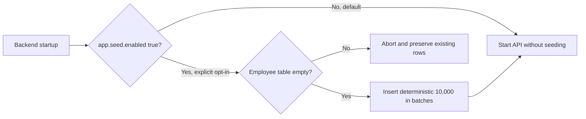
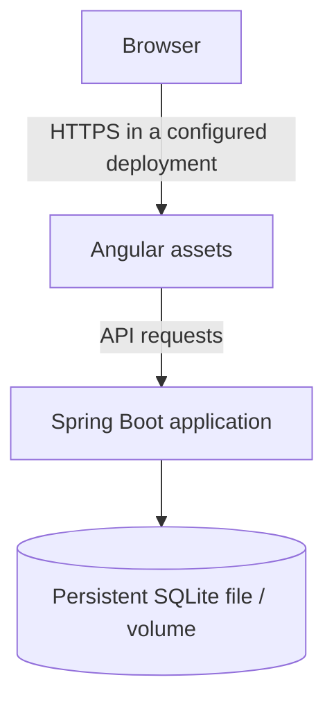

# Architecture diagrams

These diagrams represent current request flows, not proposed employee-write behavior.

## 1. Implemented system context

The UI currently reads the employee directory and salary insights. The API also has a single-employee read route. No employee-write route is implemented.

## 2. Implemented employee directory read

The endpoint supports additional country/department/salary filters and sorting parameters. Those controls are not currently exposed in the directory UI.

## 3. Implemented salary analytics read

**Currency invariant:** each analytics query is scoped to one requested currency. Country and department filters are applied to the summary and both breakdown queries. No conversion is performed.

## 4. Explicit seed startup path

## 5. Deployment target sketch (not deployed)

This is only a conceptual target. The repository does not include deployment automation, HTTPS configuration, or production operations setup. SQLite concurrency and write-scaling limits should be revisited before serving concurrent production workloads; use persistent storage and backups if deploying the demo.
