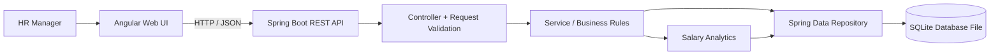
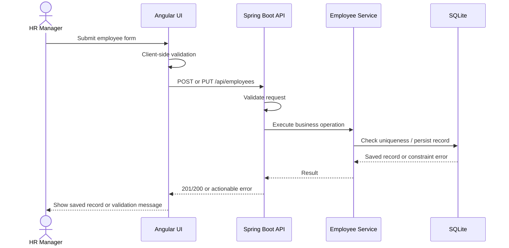
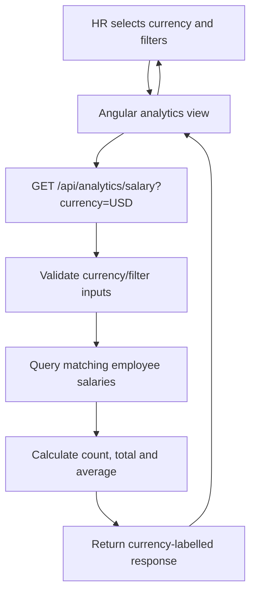
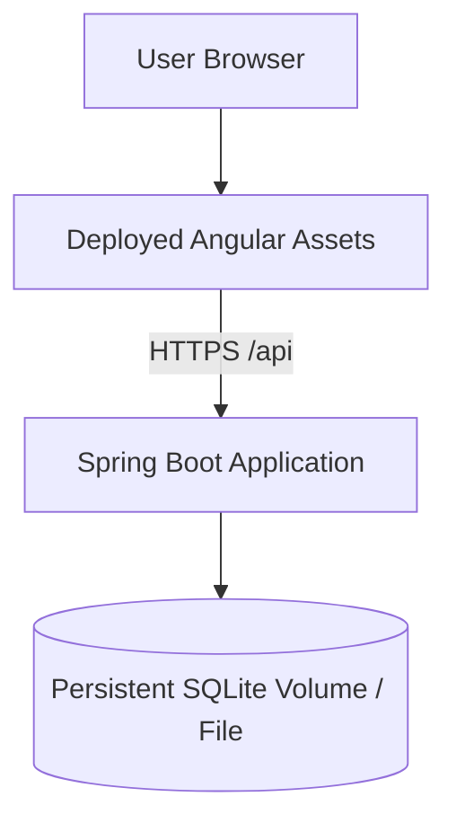

# Architecture Diagrams

## 1. System context and request flow

The browser talks only to the REST API. Controllers translate HTTP requests, services enforce business rules, and repositories perform persistence. Analytics use currency-scoped queries/calculations.

## 2. Create or update employee sequence

## 3. Salary analytics flow

**Invariant:** amounts in different currencies must never be summed into one total. Conversion is excluded until a trusted exchange-rate source and conversion date policy are specified.

## 4. Deployment shape (target)

This is a target deployment sketch, not evidence that deployment has already happened. SQLite file storage must be persistent and backed up. For horizontally scaled application instances or sustained concurrent writes, reconsider SQLite and use a server database such as PostgreSQL.
